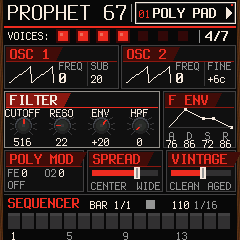
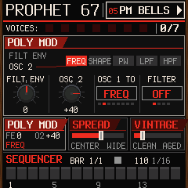
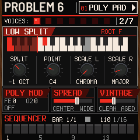
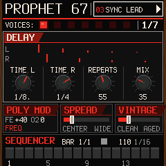

# PROPHET 67

A 7-voice analogue-style polysynth for the M-VAVE FM-1 by **swtdr34mz**, in the manner of the Sequential Prophet-6:
its voice architecture, its POLY MOD, its VINTAGE character, its effects, its knob-per-function workflow, its panel.
Built on [fm1-base](https://github.com/charlesvestal/fm1-base) and [felucca-bsp](https://github.com/hugelton/felucca-bsp).

Unofficial: not made, endorsed or supported by Sequential or M-VAVE. Install at your own risk.

     

**Handbuch (Deutsch):** [docs/HANDBUCH.md](docs/HANDBUCH.md) · **In the browser:** [emulator](https://swtdr34mz-afk.github.io/PROPHET-67/emu/)

## Install

Download `prophet67-1.0.fwsc` (or the newest) from [Releases](https://github.com/swtdr34mz-afk/PROPHET-67/releases)
and install it as any FM-1 firmware. Your presets and sequence are kept across updates.

## The voice

Seven voices, each with:

- **Two oscillators** with a continuously variable **SHAPE** (triangle → saw → pulse, crossfaded as on the Prophet-6)
  and **PULSE WIDTH**; oscillator 1 with a **triangle sub-octave**. Band-limited (polyBLEP applied at each step in the
  wave, including hard-sync resets and audio-rate pulse-width changes).
- **OSC 2 modes** (MIXER page): NORMAL, **SYNC** (oscillator 1 hard-synced to oscillator 2), **LOW FREQ** (oscillator 2
  at LFO rates, following the keys) and **LF FIXED** (the same, not following the keys): the classic Prophet poly-mod
  LFO.
- **Mixer**: OSC 1, OSC 2, SUB OCT, NOISE. Turn them all up and the filter's input saturates, as a Prophet's mixer does.
- **A 2-pole resonant high-pass** into **a 4-pole resonant low-pass**: a zero-delay-feedback ladder with a saturating
  input, self-oscillating from about RESONANCE 115, losing a little bass as the resonance rises (not all of it
  compensated: that is part of the sound). Bipolar envelope amounts for both, keyboard tracking OFF / HALF / FULL,
  velocity.
- **Two ADSR envelopes** with analogue (RC) curves: attacks aim past the top and stop there (punchy), decays and
  releases fall exponentially. Times from 1 ms to 20 s. A retriggered envelope starts from where it is.
- **Voice allocation**: free voices taken in turn (so each note meets another voice's character and a chord spreads
  across the stereo field), the quietest released voice next, the oldest held note last; a voice taken while it
  sounds is never cut: it fades out along a smooth curve in 4.5 ms, then plays the new note. A release runs its
  course down to -70 dB. A note played again while it still rings out goes to the same voice (v0.6): its character,
  pitch, filter and pressure go on from where they are. Sustain pedal, polyphonic GLIDE, UNISON (all seven on one note, legato,
  last-note priority, detuned by SPREAD).

## POLY MOD (EDIT)

As on the Prophet-5 and -6: two per-voice sources, both **bipolar**,

- **FILT ENV**: the voice's filter envelope
- **OSC 2**: the voice's oscillator 2, at **audio rate** (FM, audio-rate filter and shape modulation, worked out sample
  by sample) or, in LOW FREQ mode, as a per-voice LFO

into the destinations: **OSC 1 TO** FREQ, SHAPE, PW (any combination) and **FILTER** LPF, HPF or both. The amounts
are squared with their sign, so the first part of the knob is fine work and the end is wild. Try PM BELLS, SYNC LEAD,
PM GROWL and GLASS PAD.

## VINTAGE (SELECT)

Each voice has its own fixed character, as the voices of a well-aged poly do: tuning of each oscillator, a slow
drift, the cutoff, the resonance, the envelopes' attack, decay and release times, the level, the pulse width, the
shape. The offsets are **hand-set, not random**: every column averages near zero and no voice is extreme in
everything, so a chord stays in tune with itself and none sticks out. VINTAGE scales them all together, from 0 straight up (v0.2: much stronger than v0.1):

| VINTAGE | What you hear |
| --- | --- |
| 0 | seven identical, perfectly stable voices |
| 64 | a living poly: voices up to about ±10 cents apart, audibly brighter and darker voices, envelopes and levels differing |
| 127 | an old Prophet: each oscillator up to ±12 / ±15 cents (a voice's two oscillators beat against each other), a slow ±10 cent drift, a few cents more per keystroke, cutoff ±0.6 octave, resonance ±40 %, envelope times ±55 %, levels ±3 dB, wave shape and width, and how hard each voice drives its filter |

Measured on one note played seven times (each on the next voice) at VINTAGE 127: pitches spread over about ±20 cents,
brightness from 335 to 620 Hz, levels over 5 dB. At 0 all seven are the same to the cent.

## VOICE SPREAD (ALGORITHM)

From all seven voices in the centre to a wide, coherent stereo field. Each voice has its own place (neighbours in a
chord land on opposite sides), a few cents of detune of its own, a slightly different colour (cutoff), and on the side
away from it a fraction of a millisecond of delay, which gives width without a chorus's wobble. Measured on a 5-note
chord: L/R correlation 1.00 at 0, 0.96 at 42, 0.84 at 84, 0.49 at 127. With UNISON it also sets the stack's detune.

## Two LFOs

LFO 1 and LFO 2, each with its own RATE, AMOUNT, SHAPE and DEST; both may go to the same place (they add). The mod
wheel (CC 1) adds to LFO 1. **SYNC** locks an LFO to the clock: its phase is the clock's position, so it stays on
the beat and starts with the sequencer; RATE then steps through 4 BARS, 2 BARS, 1 BAR, 1/2, 1/4, 1/4T, 1/8, 1/8T,
1/16, 1/16T, 1/32. **RETRIG** starts it from the top on a fresh note. SWEEP PAD has LFO 1 on the filter over 2 bars,
PM GROWL a stepped LFO 2 at 1/16.

## LOW SPLIT (EDIT, twice)

OFFWORLD's low split. **LOW SPLIT** page: **SPLIT** (OFF, or the left hand 1-3 octaves down), **POINT** (the right
hand's first key; or hold SEL and press a key), **SCALE L** and **SCALE R** (CHROMA, MAJOR, MINOR, DORIAN, PHRYGIAN,
LYDIAN, MIXOLYD, HARM MIN, PENTA MAJ, PENTA MIN, BLUES, ARABIC: each hand's keys move to their scale's note at or below
them). **SPLIT KEYS** page (EDIT a third time): **KEY** (the scales' key), **FOLLOW** (KEY: the right hand's scale on
KEY; ROOT: on the root the left hand plays, its lowest note sounding, as OFFWORLD's FOLLOW; WHITE: that scale laid on
the white keys, the black keys resting), **LOW HOLD** (the left hand's notes stay until a new one is played there),
**BALANCE** (the two hands' levels). Without the split, SCALE R covers the whole keyboard. The keyboard is drawn on
the page: the low split, the point, the keys that move into the scale (grey), the root.

## AFTERTOUCH (GLO, twice)

Pressing a held key harder (the FM-1's keys sense it, F3 to C5, each key its own: polyphonic) or MIDI channel or poly
pressure: **DEST** (FILTER opens it; SWELL louder and a little brighter; POWER brighter, louder, wider and driven, as
OFFWORLD's; VIBRATO; LFO 1 more of LFO 1; PITCH up to 2 semitones; POLY MOD deeper), **AMOUNT** (bipolar: negative
closes, quietens, bends down), **CURVE** (soft: it answers early; hard: only a firm press), **SMOOTH** (3 ms .. 0.4 s
for the pressure to reach the sound). Per preset; every factory preset has its own. The page shows each voice's
pressure. When a key is let go, its pressure eases off with the release (never faster than 150 ms); the falling
reading of a key being lifted is ignored, so nothing dips before the release (v0.6). The keys also play with their own velocity now (KEY VEL on CLOCK: TOUCH, or a fixed value).

## The effects

In the Prophet-6's order:

The FX button pages through **REVERB**, **SPACE REVERB**, **CHORUS**, **DELAY** and **DELAY MOD**. In the signal:
distortion, chorus, delay, reverb (the delay's repeats go into the reverb, as pedals on a board).

- **REVERB**: **ROOM, HALL, PLATE, SPRING** (dispersive, chirpy) as the Prophet-6's unit B has, and **SPACE**, an
  ambient reverb after the Meris Mercury7: long modulated lines, deep diffusion, decays up to 70 s, and held forever at
  DECAY 127. MIX, DECAY, TONE (darker / brighter). The **PLATE** (v0.2) is dense and smooth: two allpass diffusers
  inside every line of the loop and a slow wobble smear its modes so nothing rings metallic, and it is warmer at the
  top (its persistent ringing measured down from 4.2 to 2.8 dB).
- **SPACE REVERB** (used when REVERB's TYPE is SPACE): **MODULATE** (the lines' movement, from still to lush),
  **SHIMMER** (an octave up fed back into the tail), **SWELL** (after each new note the reverb fades in, as the
  Mercury7's swell) and **PREDELAY** (up to 180 ms).
- **DELAY** (v0.6), after the Walrus Audio Meraki (its idea, not its code): a stereo delay, **TIME L** and **TIME R**
  each its own (20 ms .. 1.2 s, or with **SYNC** the clock's notes 1/32 .. 1/2 with triplets and dotted), **REPEATS**
  through a warm path (**TONE**'s low-pass darkening each repeat, the lows thinned, a soft saturation: at the top it
  runs away and holds, as a pedal does), **MIX**. **DELAY MOD**: **DEPTH** and **RATE** of the times' modulation, the
  two sides a quarter apart (wide), with a slow analogue wander underneath. A new time glides there (a tape's bend,
  never a click). Its lines are 16-bit at 22 kHz.
- **CHORUS**: two bucket-brigade-style lines swept by one triangle a quarter apart, their highs dulled, crossed for
  width. MIX, RATE, DEPTH; and **DISTORT**, the analogue-style stereo distortion before it, its fizz rounded off as it
  gets harder.

One reverb runs at a time; the SPACE algorithm has its own line lengths, diffusion and modulation, so it never changes
how ROOM, HALL, PLATE or SPRING sound.

## Sequencer and arpeggiator

- **Sequencer** (v1.1): **two tracks of 64 steps**, for two lines at once - a bass and chords, a lead and a pattern
  (two: the seven voices are shared, and more lines would leave too few for each).
  - **Each track its own sound**: a preset, edited as you like, kept with the song. The seven voices are shared by the
    two tracks (a voice plays the sound of the track whose note it plays); the effects (reverb, space, chorus,
    distortion, delay) are one set for the song: a preset loaded into track 1 brings its effects, into track 2 the
    song's stay; turning an FX page changes them for every track.
  - **Each track its own LENGTH (1-64 steps), RATE (1/8 .. 1/32, triplets), TRANSPOSE (±24) and MUTE**: tracks of
    different lengths run against each other (polymeter). SWING (CLOCK page) for all. PLAY starts them all from the top.
  - **A step**: a note or a **chord of up to 7 notes**, a rest or a **tie**, its own **velocity** and **gate** (5-100 %
    of the step).
  - **SEQ**: the TRACK page (TRACK 1-2, LENGTH, RATE, TRANSPOSE); again: MUTES & CLICK (MUTE 1, MUTE 2, the
    metronome's CLICK and VOLUME). The track selected is
    the one the keys play, the pages edit, PRESET loads a sound into, SAVE keeps, REC writes, the arp plays. The page
    shows both lines (their steps, length, playheads); the strip at the bottom the selected track's 16 steps
    around the playhead, each step as tall as its velocity and as wide as its gate.
  - **Step record**: stopped, press REC: the STEP EDIT page. Play a chord (or one note): when every finger is off it
    goes into the step (at the velocity played) and the cursor moves on. **PRESET** or **K1** move the cursor, **K2**
    sets the step's VELOCITY, **K3** its GATE, **K4** moves its notes (NOTE), **SEQ** writes a rest, **SAVE** a tie. REC
    again to finish.
  - **Live record**: playing, press REC. What you play goes into the selected track's nearest step, beside what is
    there, at its velocity and **as long as you hold it**: within a step as its gate, longer as TIEs over the steps it
    holds on (as far as they are free), the last one's gate where you let go.
  - **Metronome** (v1.1): GLO, 4th page METRONOME: CLICK (OFF, ON while the sequencer plays, REC: only while
    recording), VOLUME, BPM, SWING; the bar's first beat higher. **SEQ held 1 s** turns it on / off.
  - Every track keeps to the bar: its place is worked out from the bar since PLAY, so LENGTH or RATE turned while it
    plays never puts it off the beat (or off the metronome).
  - **REC held 1 s** clears the selected track. The song (the two sounds and lines) saves itself when stopped. A v1.0
    sequence comes over into track 1 (its first 64 steps).
- **Arpeggiator**: UP, DOWN, UP-DN, RANDOM, PLAYED; 1/8 to 1/32 with triplets; 1 to 4 octaves; GATE. **ARP held 1 s**
  is HOLD (the notes stay; a new chord replaces them).
- Both run in the audio render, on time to within 2.9 ms, and follow **MIDI clock** (START, STOP, CONTINUE) when it
  comes in.

## The controls

| Control | Does |
| --- | --- |
| Keys | play; OCT- / OCT+ shift them ±3 octaves. With the arp on they feed the arp |
| K1..K4 | the page's four knobs (bipolar knobs rest at their centre for a few detents) |
| SELECT | VINTAGE |
| ALGORITHM | VOICE SPREAD |
| PRESET | the 16 presets (step record: the step) |
| HOME | FILTER: CUTOFF, RESONANCE, ENV AMT, HP CUTOFF; again FILTER 2: HP RESO, KEYBOARD, VELOCITY, HP ENV. Held 1 s: the preset as saved |
| SEL | OSC 1: FREQ, SHAPE, PW, SUB OCT; again OSC 2: FREQ, FINE, SHAPE, PW; again MIXER: OSC 1, OSC 2, NOISE, OSC 2 mode |
| ENV | FILTER ENV (A D S R); again AMP ENV |
| LFO | LFO 1: RATE (0.05-30 Hz), AMOUNT, SHAPE (TRI, SAW, RAMP, SQUARE, S+H), DEST (FREQ 1+2, FREQ 1, FREQ 2, PW 1+2, LPF, HPF, AMP); again LFO 2 (the same); again LFO SYNC: SYNC 1, SYNC 2 (OFF, or 4 BARS .. 1/32 with triplets: locked to the clock, BPM or MIDI clock; then RATE picks the division), RETRIG 1, RETRIG 2 (a note played with no other key down starts it from the top) |
| EDIT | POLY MOD: FILT ENV, OSC 2, OSC 1 TO, FILTER; again LOW SPLIT: SPLIT, POINT, SCALE L, SCALE R; again SPLIT KEYS: KEY, FOLLOW, LOW HOLD, BALANCE |
| FX | REVERB: TYPE, MIX, DECAY, TONE; again SPACE REVERB: MODULATE, SHIMMER, SWELL, PREDELAY; again CHORUS: CHORUS, RATE, DEPTH, DISTORT; again DELAY: TIME L, TIME R, REPEATS, MIX; again DELAY MOD: DEPTH, RATE, TONE, SYNC |
| GLO | VOICE: GLIDE, VELOCITY (to the amp), UNISON, BEND (semitones); again AFTERTOUCH: DEST, AMOUNT, CURVE, SMOOTH; again CLOCK: BPM, SWING, KEY VEL (TOUCH or fixed), MIDI CH (and each core's load) |
| ARP | the arp on and its page: MODE, RATE, OCTAVES, GATE; again: off. Held 1 s: HOLD |
| SEQ | TRACK: TRACK (1-2), LENGTH, RATE, TRANSPOSE; again MUTES & CLICK (MUTE 1, MUTE 2, CLICK, VOLUME). In step record: a rest. Held 1 s: the metronome on / off |
| PLAY | the sequencer from the top / stop |
| REC | record (step or live, above). Held 1 s: clear |
| SAVE | keep the edited preset in its slot; held + PRESET: in another slot (on letting go). The SAVE light: edited, not saved |

MIDI in (USB and TRS): notes with velocity, channel and poly pressure, pitch bend, the CCs below,
clock, START, STOP, CONTINUE. MIDI out (USB): the keys' notes. The settings (presets, globals) and the sequence can be
backed up and restored over USB.

### MIDI CC (v1.4)

Nearly every knob takes a CC. Where the Prophet-6 has the same knob, it is the Prophet-6's number (its controller
templates and editors fit); the rest sit on CCs the Prophet-6 leaves free. 0..127 spans the knob (a choice: its options,
evenly). A CC edits the sound of the track on screen (the sequencer's track 1 or 2), on the MIDI channel set (GLO, CLOCK,
MIDI CH).

| CC | Knob | Note |
|---|---|---|
| 1 | MOD WHEEL | Mod wheel: more LFO 1 |
| 5 | GLIDE | Glide time (as the Prophet-6) |
| 8 | OSC 1 SUB OCT | Sub oscillator (as the Prophet-6) |
| 9 | DISTORT | Distortion (as the Prophet-6) |
| 14 | LFO 1 RATE |  |
| 15 | LFO 1 AMOUNT |  |
| 16 | LFO 1 SHAPE | choice |
| 17 | LFO 1 DEST | choice |
| 18 | LFO 2 RATE |  |
| 19 | LFO 2 AMOUNT |  |
| 20 | LFO 2 SHAPE | choice |
| 21 | LFO 2 DEST | choice |
| 22 | POLY MOD FILT ENV |  |
| 23 | POLY MOD OSC 2 |  |
| 24 | POLY MOD OSC 1 TO | choice |
| 25 | POLY MOD FILTER TO | choice |
| 26 | NOISE |  |
| 27 | OSC 2 MODE | normal / sync / low freq |
| 28 | VINTAGE |  |
| 29 | VOICE SPREAD |  |
| 30 | UNISON | off / on |
| 41 | AMP VELOCITY |  (as the Prophet-6) |
| 43 | AMP ATTACK |  (as the Prophet-6) |
| 44 | AMP DECAY |  (as the Prophet-6) |
| 45 | AMP SUSTAIN |  (as the Prophet-6) |
| 46 | AMP RELEASE |  (as the Prophet-6) |
| 47 | LPF ENV AMOUNT |  (as the Prophet-6) |
| 50 | FILTER ATTACK |  (as the Prophet-6) |
| 51 | FILTER DECAY |  (as the Prophet-6) |
| 52 | FILTER SUSTAIN |  (as the Prophet-6) |
| 53 | FILTER RELEASE |  (as the Prophet-6) |
| 54 | HPF ENV AMOUNT |  (as the Prophet-6) |
| 64 | SUSTAIN | pedal |
| 67 | OSC 1 FREQ |  (as the Prophet-6) |
| 69 | OSC 1 LEVEL | mixer (as the Prophet-6) |
| 70 | OSC 1 SHAPE |  (as the Prophet-6) |
| 71 | OSC 1 PW |  (as the Prophet-6) |
| 74 | BRIGHTNESS | added to the cutoff (as the Prophet-6) |
| 75 | OSC 2 FREQ |  (as the Prophet-6) |
| 76 | OSC 2 FINE |  (as the Prophet-6) |
| 77 | OSC 2 LEVEL | mixer (as the Prophet-6) |
| 78 | OSC 2 SHAPE |  (as the Prophet-6) |
| 79 | OSC 2 PW |  (as the Prophet-6) |
| 80 | AFTERTOUCH AMOUNT |  |
| 81 | AFTERTOUCH DEST | choice |
| 85 | CHORUS MIX |  |
| 86 | CHORUS RATE |  |
| 87 | CHORUS DEPTH |  |
| 88 | REVERB TYPE | choice |
| 89 | REVERB MIX |  |
| 90 | REVERB DECAY |  |
| 102 | LPF CUTOFF |  (as the Prophet-6) |
| 103 | LPF RESONANCE |  (as the Prophet-6) |
| 104 | LPF KEYBOARD | off / half / full (as the Prophet-6) |
| 105 | LPF VELOCITY |  (as the Prophet-6) |
| 106 | HPF CUTOFF |  (as the Prophet-6) |
| 107 | HPF RESONANCE |  (as the Prophet-6) |
| 110 | REVERB TONE |  |
| 111 | SPACE MOD |  |
| 112 | SPACE SHIMMER |  |
| 113 | SPACE SWELL |  |
| 114 | SPACE PREDELAY |  |
| 115 | DELAY MIX |  |
| 116 | DELAY FEEDBACK |  |
| 117 | DELAY TIME L |  |
| 118 | DELAY TIME R |  |
| 119 | DELAY TONE |  |
| 120 | ALL SOUND OFF |  |
| 123 | ALL NOTES OFF |  |

## The presets

POLY PAD, BRASS 6, SYNC LEAD, FAT BASS, PM BELLS, SOFT KEYS, STRINGS, SWEEP PAD, PLUCK, PM GROWL, SPACE DRIFT,
UNISON LEAD, CLAV, GLASS PAD, VINTAGE KEYS, INIT. Edits sound at once and are kept only with SAVE, as on the hardware.

## The screen

A Prophet-6's front panel for 240 × 240: black with walnut cheeks, cream legends, red section heads on their tabs,
knobs with a red pointer, the voices' red LEDs (lit by each voice's amp envelope). HOME shows the panel at a glance
(the two oscillators' waveforms, the filter, the envelope); the other pages show their section with a live view
(waveforms, envelope shapes, the LFO's trace, the poly-mod routing, the reverb's tail, where each voice stands in the
stereo field, the sixteen bars). POLY MOD, VOICE SPREAD, VINTAGE and the sequencer's bar stay in view on every page.

## Engineering notes and trade-offs

- **Saving** (v0.6): writing the flash holds the audio for 8-17 ms (an erase). The settings and the sequence are
  therefore written only after a second and a half of silence (no voice, no reverb tail, no key, the sequencer
  stopped); before, a change of preset was written 4 s later even under a held chord: the dropouts. SAVE still
  writes at once, the sound faded out and back in around it.

- **CPU** (v0.4): only the voices that sound are rendered, shared out each block between the two cores so both finish
  together (the first core also runs the effects, which cost about two to three voices: `fx_weight`); one core still
  works (`cpu2_fallback`). The voices and effects run from RAM (`.c1_text`), out of the flash cache's way. A release
  ends at -70 dB. The reverb's core runs at 22 kHz (it keeps nothing above 10 kHz), and sleeps when it has faded
  away. No division per sample in a voice. The CLOCK page shows each core's load and its peak over the last second
  (C2: at most this). Against v0.3, 31-33 % fewer instructions with seven voices in long releases. The oscillators and filters run per sample; pitches and cutoffs per 8 samples, except where
  oscillator 2 modulates them through poly mod (then per sample). If a render runs late, the quietest released voice is
  let go. The CLOCK page shows the load: please check it with heavy presets (PM GROWL, GLASS PAD, SPACE DRIFT with
  seven notes).
- **The filter moves continuously** (v0.3). CUTOFF has 256 steps (half a semitone a detent, 20 Hz to 20 kHz). Each
  knob detent (and CC 74) reaches the filter along a short S-curve (90 % in about 6 ms, more than twice as fast as v0.3), a quick turn
  sweeps the whole range in a flick, and every filter coefficient then ramps sample by
  sample from where it was, so neither knob steps nor the 8-sample control rate are heard. The filter envelope, the
  LFOs and poly mod are not smoothed: they act at once (poly mod by oscillator 2 per sample). Measured on a held
  note during a knob sweep: the sharpness of each detent's change 11-27 dB lower than v0.2.
- **No oversampling**: the oscillators are band-limited (aliasing about 40-48 dB down for a saw at C6-C7), the filter's
  saturation is gentle. 2x oversampling would double the voice cost; left out to keep seven voices on the FM-1.
- **The SPACE reverb** is an original algorithm in the spirit of the Mercury7, not a copy. Its lines are bounded by a
  soft limiter, so a held SPACE fed again and again stays stable; with SHIMMER on, DECAY stops at 30 s.
- **Not modelled**: the BBD and digital
  delays and phasers of FX A, polychain. The top seven keys (C#5-G5) have velocity but no pressure.

## Building

    git clone --recursive https://github.com/swtdr34mz-afk/PROPHET-67
    X0X_FONTSET=terminus python3 fm1-base/tools/build.py . --host
    build/host/prophet67_host tests/basic.txt build/host
    build/host/prophet67_host tests/seq.txt build/host
    build/host/prophet67_host tests/tracks.txt build/host
    build/host/prophet67_host tests/cc.txt build/host

GitHub Actions builds the `.fwsc` on every push (Actions → the run → Artifacts → prophet67-firmware), and puts the
browser emulator on GitHub Pages. A tag `v*` makes a release with the `.fwsc` attached.

## Licence

MPL-2.0. See [CREDITS.md](CREDITS.md).
