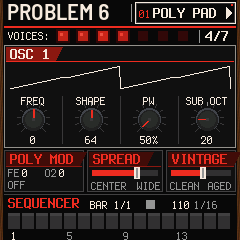
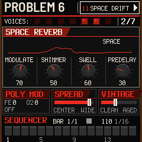

# PROPHET 67

A 7-voice analogue-style polysynth for the M-VAVE FM-1 by **swtdr34mz**, in the manner of the Sequential Prophet-6:
its voice architecture, its POLY MOD, its VINTAGE character, its effects, its knob-per-function workflow, its panel.
Built on [fm1-base](https://github.com/charlesvestal/fm1-base) and [felucca-bsp](https://github.com/hugelton/felucca-bsp).

Unofficial: not made, endorsed or supported by Sequential or M-VAVE. Install at your own risk.

   

**Handbuch (Deutsch):** [docs/HANDBUCH.md](docs/HANDBUCH.md) · **In the browser:** [emulator](https://swtdr34mz-afk.github.io/PROPHET-67/emu/)

## The voice

Seven voices, each with:

- **Two oscillators** with a continuously variable **SHAPE** (triangle → saw → pulse, crossfaded as on the Prophet-6)
  and **PULSE WIDTH**; oscillator 1 with a **triangle sub-octave**. Band-limited (polyBLEP applied at each step in the
  wave, including hard-sync resets and audio-rate pulse-width changes).
- **OSC 2 modes** (MIXER page): NORMAL, **SYNC** (oscillator 1 hard-synced to oscillator 2), **LOW FREQ** (oscillator 2
  at LFO rates, following the keys) and **LF FIXED** (the same, not following the keys): the classic Prophet poly-mod
  LFO.
- **Mixer**: OSC 1, OSC 2, SUB OCT, NOISE. Turn them all up and the filter's input saturates, as a Prophet's mixer does.
- **A 2-pole resonant high-pass** into **a 4-pole resonant low-pass**: a zero-delay-feedback ladder with a saturating
  input, self-oscillating from about RESONANCE 115, losing a little bass as the resonance rises (not all of it
  compensated: that is part of the sound). Bipolar envelope amounts for both, keyboard tracking OFF / HALF / FULL,
  velocity.
- **Two ADSR envelopes** with analogue (RC) curves: attacks aim past the top and stop there (punchy), decays and
  releases fall exponentially. Times from 1 ms to 20 s. A retriggered envelope starts from where it is.
- **Voice allocation**: free voices taken in turn (so each note meets another voice's character and a chord spreads
  across the stereo field), the quietest released voice next, the oldest note last; a voice taken while it sounds
  fades out in 2 ms first (no clicks). Sustain pedal, polyphonic GLIDE, UNISON (all seven on one note, legato,
  last-note priority, detuned by SPREAD).

## POLY MOD (EDIT)

As on the Prophet-5 and -6: two per-voice sources, both **bipolar**,

- **FILT ENV**: the voice's filter envelope
- **OSC 2**: the voice's oscillator 2, at **audio rate** (FM, audio-rate filter and shape modulation, worked out sample
  by sample) or, in LOW FREQ mode, as a per-voice LFO

into the destinations: **OSC 1 TO** FREQ, SHAPE, PW (any combination) and **FILTER** LPF, HPF or both. The amounts
are squared with their sign, so the first part of the knob is fine work and the end is wild. Try PM BELLS, SYNC LEAD,
PM GROWL and GLASS PAD.

## VINTAGE (SELECT)

Each voice has its own fixed character, as the voices of a well-aged poly do: tuning of each oscillator, a slow
drift, the cutoff, the resonance, the envelopes' attack, decay and release times, the level, the pulse width, the
shape. The offsets are **hand-set, not random**: every column averages near zero and no voice is extreme in
everything, so a chord stays in tune with itself and none sticks out. VINTAGE scales them all together, from 0 straight up (v0.2: much stronger than v0.1):

| VINTAGE | What you hear |
| --- | --- |
| 0 | seven identical, perfectly stable voices |
| 64 | a living poly: voices up to about ±10 cents apart, audibly brighter and darker voices, envelopes and levels differing |
| 127 | an old Prophet: each oscillator up to ±12 / ±15 cents (a voice's two oscillators beat against each other), a slow ±10 cent drift, a few cents more per keystroke, cutoff ±0.6 octave, resonance ±40 %, envelope times ±55 %, levels ±3 dB, wave shape and width, and how hard each voice drives its filter |

Measured on one note played seven times (each on the next voice) at VINTAGE 127: pitches spread over about ±20 cents,
brightness from 335 to 620 Hz, levels over 5 dB. At 0 all seven are the same to the cent.

## VOICE SPREAD (ALGORITHM)

From all seven voices in the centre to a wide, coherent stereo field. Each voice has its own place (neighbours in a
chord land on opposite sides), a few cents of detune of its own, a slightly different colour (cutoff), and on the side
away from it a fraction of a millisecond of delay, which gives width without a chorus's wobble. Measured on a 5-note
chord: L/R correlation 1.00 at 0, 0.96 at 42, 0.84 at 84, 0.49 at 127. With UNISON it also sets the stack's detune.

## Two LFOs

LFO 1 and LFO 2, each with its own RATE, AMOUNT, SHAPE and DEST; both may go to the same place (they add). The mod
wheel (CC 1) adds to LFO 1. **SYNC** locks an LFO to the clock: its phase is the clock's position, so it stays on
the beat and starts with the sequencer; RATE then steps through 4 BARS, 2 BARS, 1 BAR, 1/2, 1/4, 1/4T, 1/8, 1/8T,
1/16, 1/16T, 1/32. **RETRIG** starts it from the top on a fresh note. SWEEP PAD has LFO 1 on the filter over 2 bars,
PM GROWL a stepped LFO 2 at 1/16.

## The effects

In the Prophet-6's order:

The FX button pages through **REVERB**, **SPACE REVERB** and **CHORUS**.

- **REVERB**: **ROOM, HALL, PLATE, SPRING** (dispersive, chirpy) as the Prophet-6's unit B has, and **SPACE**, an
  ambient reverb after the Meris Mercury7: long modulated lines, deep diffusion, decays up to 70 s, and held forever at
  DECAY 127. MIX, DECAY, TONE (darker / brighter). The **PLATE** (v0.2) is dense and smooth: two allpass diffusers
  inside every line of the loop and a slow wobble smear its modes so nothing rings metallic, and it is warmer at the
  top (its persistent ringing measured down from 4.2 to 2.8 dB).
- **SPACE REVERB** (used when REVERB's TYPE is SPACE): **MODULATE** (the lines' movement, from still to lush),
  **SHIMMER** (an octave up fed back into the tail), **SWELL** (after each new note the reverb fades in, as the
  Mercury7's swell) and **PREDELAY** (up to 180 ms).
- **CHORUS**: two bucket-brigade-style lines swept by one triangle a quarter apart, their highs dulled, crossed for
  width. MIX, RATE, DEPTH; and **DISTORT**, the analogue-style stereo distortion before it, its fizz rounded off as it
  gets harder.

One reverb runs at a time; the SPACE algorithm has its own line lengths, diffusion and modulation, so it never changes
how ROOM, HALL, PLATE or SPRING sound.

## Sequencer and arpeggiator

- **Sequencer**: up to **16 bars** of 16 steps, each step holding a **chord of up to 7 notes**, a rest or a **tie**.
  RATE 1/8, 1/8T, 1/16, 1/16T, 1/32; GATE; TRANSPOSE ±24; SWING (CLOCK page). PLAY starts it from the top.
  - **Step record**: stopped, press REC. Play a chord (or one note): when every finger is off it goes into the step and
    the cursor moves on. **PRESET** moves the cursor, **SEQ** writes a rest, **SAVE** a tie. REC again to finish.
  - **Live record**: playing, press REC. What you play goes into the nearest step, beside what is there.
  - **REC held 1 s** clears the sequence. It saves itself when stopped.
- **Arpeggiator**: UP, DOWN, UP-DN, RANDOM, PLAYED; 1/8 to 1/32 with triplets; 1 to 4 octaves; GATE. **ARP held 1 s**
  is HOLD (the notes stay; a new chord replaces them).
- Both run in the audio render, on time to within 2.9 ms, and follow **MIDI clock** (START, STOP, CONTINUE) when it
  comes in.

## The controls

| Control | Does |
| --- | --- |
| Keys | play; OCT- / OCT+ shift them ±3 octaves. With the arp on they feed the arp |
| K1..K4 | the page's four knobs (bipolar knobs rest at their centre for a few detents) |
| SELECT | VINTAGE |
| ALGORITHM | VOICE SPREAD |
| PRESET | the 16 presets (step record: the step) |
| HOME | FILTER: CUTOFF, RESONANCE, ENV AMT, HP CUTOFF; again FILTER 2: HP RESO, KEYBOARD, VELOCITY, HP ENV. Held 1 s: the preset as saved |
| SEL | OSC 1: FREQ, SHAPE, PW, SUB OCT; again OSC 2: FREQ, FINE, SHAPE, PW; again MIXER: OSC 1, OSC 2, NOISE, OSC 2 mode |
| ENV | FILTER ENV (A D S R); again AMP ENV |
| LFO | LFO 1: RATE (0.05-30 Hz), AMOUNT, SHAPE (TRI, SAW, RAMP, SQUARE, S+H), DEST (FREQ 1+2, FREQ 1, FREQ 2, PW 1+2, LPF, HPF, AMP); again LFO 2 (the same); again LFO SYNC: SYNC 1, SYNC 2 (OFF, or 4 BARS .. 1/32 with triplets: locked to the clock, BPM or MIDI clock; then RATE picks the division), RETRIG 1, RETRIG 2 (a note played with no other key down starts it from the top) |
| EDIT | POLY MOD: FILT ENV, OSC 2, OSC 1 TO, FILTER |
| FX | REVERB: TYPE, MIX, DECAY, TONE; again SPACE REVERB: MODULATE, SHIMMER, SWELL, PREDELAY; again CHORUS: CHORUS, RATE, DEPTH, DISTORT |
| GLO | VOICE: GLIDE, VELOCITY (to the amp), UNISON, BEND (semitones); again CLOCK: BPM, SWING, KEY VEL, MIDI CH (and the CPU load) |
| ARP | the arp on and its page: MODE, RATE, OCTAVES, GATE; again: off. Held 1 s: HOLD |
| SEQ | SEQUENCER: BARS, RATE, GATE, TRANSPOSE |
| PLAY | the sequencer from the top / stop |
| REC | record (step or live, above). Held 1 s: clear |
| SAVE | keep the edited preset in its slot; held + PRESET: in another slot (on letting go). The SAVE light: edited, not saved |

MIDI in (USB and TRS): notes with velocity, pitch bend, CC 1 (mod wheel: more LFO), CC 64 (sustain), CC 74 (cutoff),
clock, START, STOP, CONTINUE. MIDI out (USB): the keys' notes. The settings (presets, globals) and the sequence can be
backed up and restored over USB.

## The presets

POLY PAD, BRASS 6, SYNC LEAD, FAT BASS, PM BELLS, SOFT KEYS, STRINGS, SWEEP PAD, PLUCK, PM GROWL, SPACE DRIFT,
UNISON LEAD, CLAV, GLASS PAD, VINTAGE KEYS, INIT. Edits sound at once and are kept only with SAVE, as on the hardware.

## The screen

A Prophet-6's front panel for 240 × 240: black with walnut cheeks, cream legends, red section heads on their tabs,
knobs with a red pointer, the voices' red LEDs (lit by each voice's amp envelope). HOME shows the panel at a glance
(the two oscillators' waveforms, the filter, the envelope); the other pages show their section with a live view
(waveforms, envelope shapes, the LFO's trace, the poly-mod routing, the reverb's tail, where each voice stands in the
stereo field, the sixteen bars). POLY MOD, VOICE SPREAD, VINTAGE and the sequencer's bar stay in view on every page.

## Engineering notes and trade-offs

- **CPU** (v0.1 measured 71-76 % on the heaviest presets): two voices and the effects on the first core, five voices on the second (`cpu2`); one core still works
  (`cpu2_fallback`). The oscillators and filters run per sample; pitches and cutoffs per 8 samples, except where
  oscillator 2 modulates them through poly mod (then per sample). If a render runs late, the quietest released voice is
  let go. The CLOCK page shows the load: please check it with heavy presets (PM GROWL, GLASS PAD, SPACE DRIFT with
  seven notes).
- **The filter moves continuously** (v0.3). CUTOFF has 256 steps (half a semitone a detent, 20 Hz to 20 kHz). Each
  knob detent (and CC 74) reaches the filter spread over about 6 ms, and every filter coefficient then ramps sample by
  sample from where it was, so neither knob steps nor the 8-sample control rate are heard. The filter envelope, the
  LFOs and poly mod are not smoothed: they act at once (poly mod by oscillator 2 per sample). Measured on a held
  note during a knob sweep: the sharpness of each detent's change 11-27 dB lower than v0.2.
- **No oversampling**: the oscillators are band-limited (aliasing about 40-48 dB down for a saw at C6-C7), the filter's
  saturation is gentle. 2x oversampling would double the voice cost; left out to keep seven voices on the FM-1.
- **The SPACE reverb** is an original algorithm in the spirit of the Mercury7, not a copy. Its lines are bounded by a
  soft limiter, so a held SPACE fed again and again stays stable; with SHIMMER on, DECAY stops at 30 s.
- **Not modelled**: the Prophet-6's aftertouch routing, the BBD and digital
  delays and phasers of FX A, polychain. The keys of the FM-1 send a fixed velocity (KEY VEL); MIDI notes bring theirs.

## Building

    git clone --recursive https://github.com/swtdr34mz-afk/PROPHET-67
    X0X_FONTSET=terminus python3 fm1-base/tools/build.py . --host
    build/host/prophet67_host tests/basic.txt build/host
    build/host/prophet67_host tests/seq.txt build/host

GitHub Actions builds the `.fwsc` on every push (Actions → the run → Artifacts → prophet67-firmware), and puts the
browser emulator on GitHub Pages. A tag `v*` makes a release with the `.fwsc` attached.

## Licence

MPL-2.0. See [CREDITS.md](CREDITS.md).
